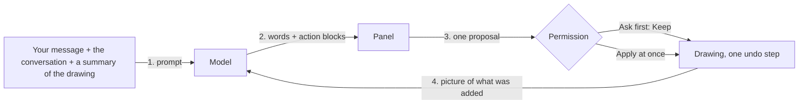

# AI assistant

A chat panel that asks Claude or Codex with the subscription you already have, or a model with your own key. Off until you turn it on in Settings, Plugins. Nothing is sent until you press send.

One assistant, no modes: say what you want and it answers, explains a topic as a page on the canvas (title, sections of pointers, diagrams, notes), rebuilds a diagram in place, changes the drawing's settings or makes a new drawing.

## Connect

- **Claude (your subscription)** and **Codex (your subscription)** use the `claude` and `codex` commands already signed in on this computer. The gear in the panel header shows *Connected*, *Not signed in* or *Not found* for each, with **Check again**. Nothing is stored by Vaultdraw: the tool keeps its own login.
- **API key** providers (Anthropic, OpenAI or any OpenAI-style address) keep a key in your system keychain. **Ollama** needs no key.

## The panel

| Part | What it does |
| --- | --- |
| Thread | Questions and answers; answers stream in as Markdown, with Copy. A proposed change shows Keep and Discard |
| Box | Enter sends, Shift+Enter is a new line, Esc stops. `@` chooses what is sent |
| Model | Searchable list grouped by provider; type any model name to use it |
| Effort | Reasoning level, where the provider has levels |
| Chip | What the next question includes (selection, drawing, nothing); click for the exact text |
| Shield | What it may do with the drawing: Ask first (default), Apply at once (with Undo), Read only. `access` setting; AI: Cycle permission mode |
| Gear | Subscriptions, keys, defaults |
| + (header) | New chat |

| Command | What it does |
| --- | --- |
| AI: Open the assistant, New chat, Choose model, Cycle reasoning effort, Cycle permission mode, Connect and settings | Panel and its controls, no default keys |
| AI: Describe the selection, Summarise this note or drawing | Send a ready request |
| AI: Keep the proposed change, Discard the proposed change | Applies it (one undo step; a new drawing is saved) or drops it |
| AI: Stop the answer, Clear the conversation | Cancels a run, empties the chat |
| AI: Set API key, Remove API key | Saves or removes the key of the provider in use |

## Notes

- A subscription run starts the tool by its full path with no shell, the question on standard input, in an empty folder, with the tool's own tools off where it has a flag. Stop or Esc kills it; it ends after 5 minutes at most.
- Changes are proposals: a plain list and a small preview, nothing changes or is saved until Keep, and Cmd+Z undoes the whole change. The app lays new content out itself (one column, below what is there, or where a replaced diagram was), so nothing overlaps.
- How it knows what to do: a short handbook is always sent (what Vaultdraw is for, the actions, layout rules, a diagram checklist); longer recipes (teach a topic, improve a diagram, notes, brainstorm, compare, settings) go along only when the message needs them. The files are in `src/handbook/`.
- After a change is applied, it looks at a picture of what it added once and fixes overlaps or cut-off text (`review`, on by default; Ask first offers the fixes to keep).
- Besides shapes, an edit can change the drawing's own settings: page mode, paper (plain, lines, grid, dots, graph, isometric), paper colours, page size, orientation, layout and the background colour. A reply with nothing usable shows a calm sentence plus the model's words, not an error.
- Summarise reads the note from the file on disk (read only).
- Offline mode stops every request except one to this computer (a local Ollama); Claude and Codex need the internet, so Offline mode stops them too.
- Ollama on another computer: set the provider to Ollama, the address to `http://192.168.1.20:11434`, and list it in `config.toml`: `[network] allow_private_hosts = ["192.168.1.20:11434"]`.
- No Vaultdraw server is involved.
